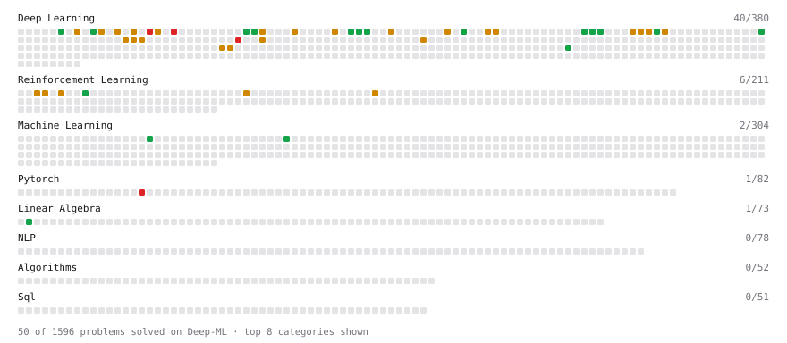

# Deep-ML

My machine learning practice from [Deep-ML](https://www.deep-ml.com). Every solution here was written by hand.

**61** solved · 61 problems · 0 labs · 0 math

[**Browse the interactive portfolio**](https://JingminW.github.io/deep-ml/) to replay this filling in over time.

## Problems

| | Difficulty | Solved | |
| --- | --- | --- | --- |
| [Adamax Optimizer](https://www.deep-ml.com/problems/148) | easy | 2026-10-15 | [solution](problems/0148-adamax-optimizer) |
| [Bias-less LayerNorm with Float32 Compute](https://www.deep-ml.com/problems/1042) | easy | 2026-09-30 | [solution](problems/1042-bias-less-layernorm-with-float32-compute) |
| [Calculate Mean Absolute Error (MAE)](https://www.deep-ml.com/problems/93) | easy | 2026-10-08 | [solution](problems/0093-calculate-mean-absolute-error-mae) |
| [Exponential Moving Average (EMA) for Diffusion Model Weights](https://www.deep-ml.com/problems/401) | easy | 2026-10-28 | [solution](problems/0401-exponential-moving-average-ema-for-diffusion-model-weights) |
| [GeLU Activation Function ](https://www.deep-ml.com/problems/147) | easy | 2026-09-25 | [solution](problems/0147-gelu-activation-function) |
| [Implement 2D Average Pooling](https://www.deep-ml.com/problems/265) | easy | 2026-10-01 | [solution](problems/0265-implement-2d-average-pooling) |
| [Implement a Simple Residual Block with Shortcut Connection](https://www.deep-ml.com/problems/113) | easy | 2026-09-21 | [solution](problems/0113-implement-a-simple-residual-block-with-shortcut-connection) |
| [Implement Binary Cross-Entropy Loss](https://www.deep-ml.com/problems/263) | easy | 2026-09-26 | [solution](problems/0263-implement-binary-cross-entropy-loss) |
| [Implement Global Average Pooling](https://www.deep-ml.com/problems/114) | easy | 2026-09-21 | [solution](problems/0114-implement-global-average-pooling) |
| [Implement Gradient Clipping by Value](https://www.deep-ml.com/problems/292) | easy | 2026-10-24 | [solution](problems/0292-implement-gradient-clipping-by-value) |
| [Implement He Weight Initialization](https://www.deep-ml.com/problems/290) | easy | 2026-10-02 | [solution](problems/0290-implement-he-weight-initialization) |
| [Implement Ridge Regression Loss Function](https://www.deep-ml.com/problems/43) | easy | 2026-10-08 | [solution](problems/0043-implement-ridge-regression-loss-function) |
| [Implement RMSNorm (Root Mean Square Layer Normalization)](https://www.deep-ml.com/problems/372) | easy | 2026-10-19 | [solution](problems/0372-implement-rmsnorm-root-mean-square-layer-normalization) |
| [Implement the Softplus Activation Function](https://www.deep-ml.com/problems/99) | easy | 2026-10-20 | [solution](problems/0099-implement-the-softplus-activation-function) |
| [Implement the Tanh Activation Function](https://www.deep-ml.com/problems/264) | easy | 2026-10-17 | [solution](problems/0264-implement-the-tanh-activation-function) |
| [Implement Xavier/Glorot Weight Initialization](https://www.deep-ml.com/problems/369) | easy | 2026-10-08 | [solution](problems/0369-implement-xavier-glorot-weight-initialization) |
| [Implementation of Log Softmax Function](https://www.deep-ml.com/problems/39) | easy | 2026-09-14 | [solution](problems/0039-implementation-of-log-softmax-function) |
| [Leaky ReLU Activation Function](https://www.deep-ml.com/problems/44) | easy | 2026-10-10 | [solution](problems/0044-leaky-relu-activation-function) |
| [Momentum Optimizer](https://www.deep-ml.com/problems/146) | easy | 2026-09-23 | [solution](problems/0146-momentum-optimizer) |
| [Thanksgiving Feast Predictor: Softmax for Dish Selection](https://www.deep-ml.com/problems/216) | easy | 2026-10-04 | [solution](problems/0216-thanksgiving-feast-predictor-softmax-for-dish-selection) |
| [Transpose of a Matrix](https://www.deep-ml.com/problems/2) | easy | 2026-10-08 | [solution](problems/0002-transpose-of-a-matrix) |
| [Upper Confidence Bound (UCB) Action Selection](https://www.deep-ml.com/problems/162) | easy | 2026-10-12 | [solution](problems/0162-upper-confidence-bound-ucb-action-selection) |
| [Adam Optimizer](https://www.deep-ml.com/problems/87) | medium | 2026-09-21 | [solution](problems/0087-adam-optimizer) |
| [Bellman Expectation Equation for State-Value Function](https://www.deep-ml.com/problems/464) | medium | 2026-10-13 | [solution](problems/0464-bellman-expectation-equation-for-state-value-function) |
| [Build Scaled Dot-Product Attention](https://www.deep-ml.com/problems/490) | medium | 2026-09-14 | [solution](problems/0490-build-scaled-dot-product-attention) |
| [Calculate Number of Parameters in Neural Network](https://www.deep-ml.com/problems/291) | medium | 2026-10-07 | [solution](problems/0291-calculate-number-of-parameters-in-neural-network) |
| [Diffusion Reconstruction Loss](https://www.deep-ml.com/problems/302) | medium | 2026-10-26 | [solution](problems/0302-diffusion-reconstruction-loss) |
| [Dropout Layer](https://www.deep-ml.com/problems/151) | medium | 2026-10-05 | [solution](problems/0151-dropout-layer) |
| [Epsilon-Greedy Action Selection for n-Armed Bandit](https://www.deep-ml.com/problems/158) | medium | 2026-10-13 | [solution](problems/0158-epsilon-greedy-action-selection-for-n-armed-bandit) |
| [Forward & Backward Diffusion Process](https://www.deep-ml.com/problems/304) | medium | 2026-10-25 | [solution](problems/0304-forward-backward-diffusion-process) |
| [Forward Diffusion Process](https://www.deep-ml.com/problems/303) | medium | 2026-10-21 | [solution](problems/0303-forward-diffusion-process) |
| [Gridworld Policy Evaluation](https://www.deep-ml.com/problems/142) | medium | 2026-10-12 | [solution](problems/0142-gridworld-policy-evaluation) |
| [Implement a Vision Transformer (ViT) Image Encoder](https://www.deep-ml.com/problems/720) | medium | 2026-10-22 | [solution](problems/0720-implement-a-vision-transformer-vit-image-encoder) |
| [Implement Adam Optimization Algorithm](https://www.deep-ml.com/problems/49) | medium | 2026-09-17 | [solution](problems/0049-implement-adam-optimization-algorithm) |
| [Implement Batch Normalization for BCHW Input](https://www.deep-ml.com/problems/115) | medium | 2026-09-24 | [solution](problems/0115-implement-batch-normalization-for-bchw-input) |
| [Implement Batched Causal Self-Attention](https://www.deep-ml.com/problems/957) | medium | 2026-10-14 | [solution](problems/0957-implement-batched-causal-self-attention) |
| [Implement Gated Attention](https://www.deep-ml.com/problems/271) | medium | 2026-09-15 | [solution](problems/0271-implement-gated-attention) |
| [Implement Group Normalization](https://www.deep-ml.com/problems/126) | medium | 2026-09-26 | [solution](problems/0126-implement-group-normalization) |
| [Implement Grouped Query Attention (GQA)](https://www.deep-ml.com/problems/391) | medium | 2026-09-19 | [solution](problems/0391-implement-grouped-query-attention-gqa) |
| [Implement GRU Cell](https://www.deep-ml.com/problems/287) | medium | 2026-10-11 | [solution](problems/0287-implement-gru-cell) |
| [Implement Long Short-Term Memory (LSTM) Network](https://www.deep-ml.com/problems/59) | medium | 2026-10-11 | [solution](problems/0059-implement-long-short-term-memory-lstm-network) |
| [Implement Multiquery Attention (MQA)](https://www.deep-ml.com/problems/390) | medium | 2026-09-17 | [solution](problems/0390-implement-multiquery-attention-mqa) |
| [Implement Q-Learning Algorithm for MDPs](https://www.deep-ml.com/problems/133) | medium | 2026-10-13 | [solution](problems/0133-implement-q-learning-algorithm-for-mdps) |
| [Implement Variational Autoencoder (VAE) Loss (ELBO)](https://www.deep-ml.com/problems/393) | medium | 2026-10-11 | [solution](problems/0393-implement-variational-autoencoder-vae-loss-elbo) |
| [Implement Xavier/Glorot Weight Initialization](https://www.deep-ml.com/problems/289) | medium | 2026-10-05 | [solution](problems/0289-implement-xavier-glorot-weight-initialization) |
| [Implementing a Simple RNN](https://www.deep-ml.com/problems/54) | medium | 2026-09-14 | [solution](problems/0054-implementing-a-simple-rnn) |
| [Inference Head Pruning for Transformers](https://www.deep-ml.com/problems/233) | medium | 2026-10-25 | [solution](problems/0233-inference-head-pruning-for-transformers) |
| [Instance Normalization (IN) Implementation](https://www.deep-ml.com/problems/143) | medium | 2026-09-26 | [solution](problems/0143-instance-normalization-in-implementation) |
| [LoRA: Low-Rank Adaptation Forward Pass](https://www.deep-ml.com/problems/222) | medium | 2026-09-28 | [solution](problems/0222-lora-low-rank-adaptation-forward-pass) |
| [Multi-Head Attention via Head Stacking](https://www.deep-ml.com/problems/958) | medium | 2026-10-14 | [solution](problems/0958-multi-head-attention-via-head-stacking) |
| [Noise Prediction Loss for Diffusion Training](https://www.deep-ml.com/problems/400) | medium | 2026-10-22 | [solution](problems/0400-noise-prediction-loss-for-diffusion-training) |
| [Overlapping Max Pooling](https://www.deep-ml.com/problems/190) | medium | 2026-10-03 | [solution](problems/0190-overlapping-max-pooling) |
| [PPO Clipped Surrogate Loss with Clip Diagnostics](https://www.deep-ml.com/problems/485) | medium | 2026-10-12 | [solution](problems/0485-ppo-clipped-surrogate-loss-with-clip-diagnostics) |
| [Pre-Norm vs Post-Norm Transformer Block](https://www.deep-ml.com/problems/408) | medium | 2026-10-16 | [solution](problems/0408-pre-norm-vs-post-norm-transformer-block) |
| [QK-Norm (Query-Key Normalization)](https://www.deep-ml.com/problems/407) | medium | 2026-10-18 | [solution](problems/0407-qk-norm-query-key-normalization) |
| [QLoRA: Quantized Low-Rank Adaptation Forward Pass](https://www.deep-ml.com/problems/223) | medium | 2026-09-29 | [solution](problems/0223-qlora-quantized-low-rank-adaptation-forward-pass) |
| [Simple Convolutional 2D Layer](https://www.deep-ml.com/problems/41) | medium | 2026-09-21 | [solution](problems/0041-simple-convolutional-2d-layer) |
| [Implement Multi-Head Attention](https://www.deep-ml.com/problems/94) | hard | 2026-09-15 | [solution](problems/0094-implement-multi-head-attention) |
| [Implement Multi-Head Self-Attention](https://www.deep-ml.com/problems/904) | hard | 2026-09-19 | [solution](problems/0904-implement-multi-head-self-attention) |
| [Multi-Head Latent Attention (MLA)](https://www.deep-ml.com/problems/405) | hard | 2026-09-15 | [solution](problems/0405-multi-head-latent-attention-mla) |
| [Positional Encoding Calculator](https://www.deep-ml.com/problems/85) | hard | 2026-09-21 | [solution](problems/0085-positional-encoding-calculator) |

---

_This file is regenerated by Deep-ML on every push._
